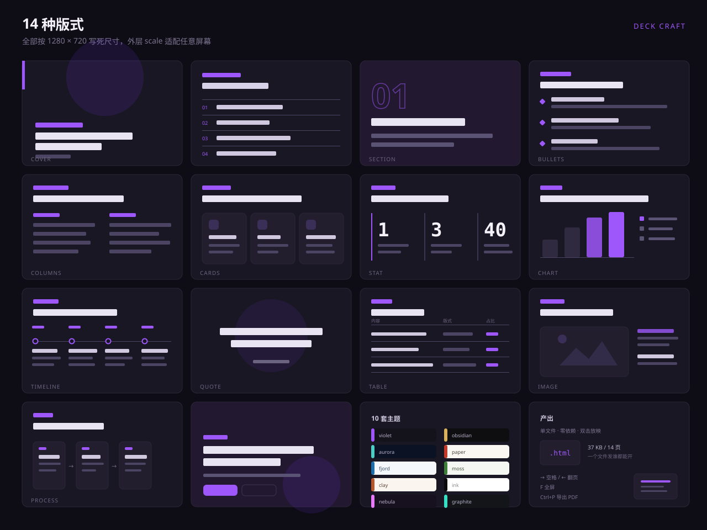

# Deck Craft

给 AI Agent 用的 PPT 制作技能。说一句话，得到一份能直接上台放的演示稿。

**[→ 在线看效果](https://honey-yy.github.io/deck-craft/)**（14 页，方向键翻页，F 全屏）

产物是**单个 HTML 文件**：双击就放，方向键翻页，F 全屏，Ctrl+P 出 PDF。没有服务器、没有账号、没有 API Key、没有 `npm install`。

```
你：给管理层做一份 Q3 经营复盘，12 页，会议室投影

Agent：（交大纲，等你确认）

你：可以

Agent：（写 12 页，自检，打包）

→ dist/deck.html   一个文件，发谁都能打开
```

---

## 为什么不是"让 AI 直接写 HTML"

直接让 AI 写 PPT，你会得到三种东西：能跑但不好看的、好看但内容空的、以及两者都有的但每次都长得不一样。

这个技能解决的是**每次都稳定**的问题：

| 问题 | 解法 |
|---|---|
| 版式每次都不一样，越改越乱 | 14 种版式的尺寸和间距已经写死在 CSS 里，AI 只填文字，不碰布局 |
| 标题是「市场分析」这种分类名 | 硬规则：标题必须是判断句，自检会拦 |
| 数据张口就来 | 硬规则：无出处不许上页面，标「示意」或改成定性 |
| 一次吐出 15 页，回头全要重写 | 流程门禁：先交大纲，确认后才写页面 |
| 配色像 2010 年的模板 | 10 套主题，按行业选，不按喜好 |
| 生成完不知道能不能用 | `check.mjs` 查结构，人眼再看一遍，然后才打包 |

---

## 安装

Skill 就是**一个目录**。放到任何支持 Agent Skills 的宿主里都能用。

### 自动（有 skills 目录的宿主）

```bash
git clone https://github.com/Honey-YY/deck-craft.git \
  ~/.claude/skills/deck-craft        # Claude Code
  # 或
  ~/.agents/skills/deck-craft        # 通用 agent、WorkBuddy、DSH
  # 或
  ~/.codex/skills/deck-craft         # Codex
```

Windows：

```powershell
git clone https://github.com/Honey-YY/deck-craft.git "$env:USERPROFILE\.agents\skills\deck-craft"
```

重启宿主，说「做个 PPT」就会自动触发。

### 手动（任何 agent 都行）

不用任何 skill 机制，直接把这句话发给你的 agent：

```
读 <deck-craft 目录>/SKILL.md，按里面的流程帮我做一份 PPT。
主题是：<你的主题>
```

Agent 读完 `SKILL.md` 就知道该怎么做了。

### 依赖

只需要 **Node.js**（跑自检和打包脚本）。没有 npm 依赖。

不放 node 也能用——手动复制版式、手动内联 CSS 即可，只是没有自动检查和打包。

---

## 三步上手

```bash
# 1. 建骨架
node scripts/new.mjs 我的演示稿 --theme obsidian --title "2026 年度经营规划"

# 2. 写页面（复制 assets/deck.html 里的版式，改文字）

# 3. 自检 + 打包
node scripts/check.mjs 我的演示稿
node scripts/build.mjs 我的演示稿
```

`我的演示稿/dist/deck.html` 就是成品。

更常见的用法是**什么都不用敲**——直接跟 agent 说你要什么稿子。

---

## 它长什么样



打开 [`examples/怎么做出好演示稿/dist/deck.html`](examples/) 就是成品。14 页，把 14 种版式各用了一次。

结构：

```
1  cover     怎么做出好演示稿
2  agenda    这份稿子讲五件事
3  section   01 先想清楚给谁看
4  bullets   没想清楚受众的三个信号
5  columns   把分类名改成观点
6  cards     三种页面骨架覆盖九成场景
7  stat      一页的字数上限
8  chart     观众记住的是形状，不是数字
9  timeline  一份稿子的生成顺序
10 quote     一句话原则
11 table     版式速查
12 image     图不是装饰，是证据
13 process   四步做完整份稿
14 end       现在，说你要做什么稿子
```

---

## 14 种版式

选版式看**内容的形状**，不看好看。

| 你手上的内容 | 版式 |
|---|---|
| 开场立题 | `cover` |
| 预告结构（3–6 项） | `agenda` |
| 段落切换 | `section` |
| 一个结论 + 2–4 条理由 | `bullets` |
| 两方对照、前后对比 | `columns` |
| 3/4/6 个并列模块 | `cards` |
| 1–3 个大数字 | `stat` |
| 占比、增速、排名 | `chart` |
| 阶段、演化、排期 | `timeline` |
| 一句原则 | `quote` |
| 参数、选项对照（≤6 行） | `table` |
| 截图为主 | `image` |
| 步骤、链路、分工 | `process` |
| 收尾、行动号召 | `end` |

全部尺寸按 **1280 × 720** 写死，外层 `transform: scale()` 适配任意屏幕。所以屏幕上看到的比例，和导出的 PDF 完全一致。

---

## 10 套主题

按行业和场合选，不按喜好。切换只改 `<html data-theme="...">` 一处。

| 主题 | 适合 |
|---|---|
| `violet` 紫电 | 科技、AI、互联网、产品发布 |
| `obsidian` 曜石·金 | 高端商务、金融、年度汇报、路演 |
| `aurora` 极光 | 数据、云、基础设施 |
| `paper` 纸感 | 文化、教育、品牌、出版 |
| `fjord` 峡湾 | 企业服务、咨询、B 端方案 |
| `moss` 苔原 | 环保、医疗、公共事务 |
| `clay` 赤陶 | 消费、零售、设计 |
| `ink` 墨白 | 极简、学术、正式答辩 |
| `nebula` 星尘 | 创意、营销、活动 |
| `graphite` 石墨·电光 | 硬件、工程、开发者 |

要客户品牌色，`references/themes.md` 里有定制配方。

---

## 放映与导出

| 操作 | 键 |
|---|---|
| 下一页 | `→` `空格` `PageDown` 或点右半屏 |
| 上一页 | `←` `PageUp` 或点左半屏 |
| 首页 / 末页 | `Home` / `End` |
| 全屏 | `F` |
| 退出全屏 | `Esc` |
| 直达某页 | URL 加 `#7` |

导 PDF：浏览器 `Ctrl/Cmd + P` → 目标「另存为 PDF」→ 边距「无」→ 勾「背景图形」。`@media print` 已配好，每页正好一张 16:9。

> 产物是网页，不是 `.pptx`。需要 pptx 就先导 PDF 再用 WPS / PowerPoint 打开另存。

---

## 目录

```
deck-craft/
├── SKILL.md              Agent 读这个（流程 + 铁律 + 速查）
├── assets/
│   ├── deck.html         完整示例，14 种版式各一页（复制骨架用这个）
│   ├── skeleton.html     新建项目的空壳
│   ├── themes.css        10 套主题变量
│   ├── layouts.css       14 种版式全部样式
│   └── player.js         放映器
├── scripts/
│   ├── new.mjs           建骨架
│   ├── check.mjs         结构自检（页数/标题/溢出/占位符/data-n/主题）
│   └── build.mjs         内联打包成单文件
├── references/
│   ├── pipeline.md       七步流程与话术、异常处理
│   ├── layouts.md        每种版式的字段、字数上限、反例
│   ├── themes.md         10 套主题完整色值 + 定制配方
│   ├── writing.md        标题公式、数字规范、禁用词、坏稿改法
│   └── quality.md        交付前验收清单
└── examples/
    └── 怎么做出好演示稿/  成品参考
```

---

## 设计来源

这套流程与视觉系统来自对 [AiPPT](https://www.aippt.cn) 网页 PPT 工作台（`/agent/generate`）的生产构建产物逆向，提取了其中可复用的部分：

- **确认门禁** —— 其 23 条系统提示词模板里，几乎每条都以「先确认理解与大纲，再输出」结尾。说明这不是可选步骤，是产品级约束。
- **一页一观点** —— `ai_single_page` 模板原文：「提炼一个核心结论和最多 3–5 个支撑点…不生成多页，不扭曲数据，不遗漏关键风险」。
- **不编造** —— 多条模板反复强调「不修改数据、不删除结论、不编造信息」。
- **数据优先图表化** —— `long_text_to_ppt` 模板原文。
- **视觉系统** —— 主色 `#7733F8`、深色底 `#1d1b21`、卡片圆角 12px、双套亮暗 token。本项目的 `violet` 主题即为同款配色。

没有复刻它的界面（那是另一个产品），只把让它产出稳定质量的那几条规矩拿了过来，配上可以落地的版式和自检。

---

## License

MIT

---

## English

A skill for AI agents that turns a sentence into a presentable slide deck. Output is a **single self-contained HTML file** — double-click to present, arrow keys to navigate, `F` for fullscreen, `Ctrl+P` for PDF. No server, no account, no API key, no `npm install`.

14 layouts, 10 themes, one hard-wired rule set: one idea per slide, no fabricated numbers, outline confirmed before any page gets written.
